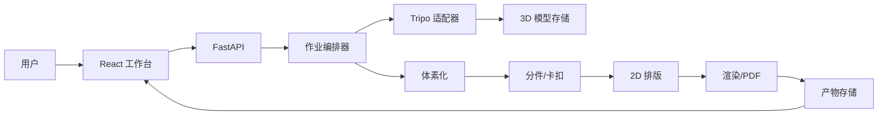

# 系统架构

## 1. 架构目标

- 把“外部模型重建”和“拼豆可制造性算法”隔离，Tripo 可替换。
- 领域算法纯 Python、可单测、可复现，不依赖 Web 框架。
- 每个阶段都有明确输入/输出和可持久化中间产物，便于重跑和排错。
- 前端只消费契约，不复制算法规则。
- 路线守卫是硬边界，任何导出前都必须经过。

## 2. 系统上下文



## 3. 模块边界

### `apps/api/app/domain`

纯领域层。包含：

- 拼豆规格 `BeadSpec`
- 体素网格 `VoxelGrid`
- 水平层 `Layer`、4-连通分量 `LayerComponent` 和单位边界边 `BoundaryEdge`（M3-T1）
- 闭合轮廓 `Contour`、分量轮廓 `ComponentContours` 和层轮廓 `LayerContours`（M3-T2）
- 层带 `LayerBand`、层带指标 `LayerBandMetrics` 和相邻层 transition（M3-T3）
- 水平环片 `HorizontalPlate`、跳过记录 `SkippedHorizontalComponent` 和提取结果 `HorizontalPlateExtraction`（M3-T4）
- 垂直围板 `VerticalPlate`、配置 `VerticalPlateConfig` 和提取结果 `VerticalPlateExtraction`（M3-T5）
- 板件接触图 `PlateContactEdge`、`PlateContactGraph` 和 `PlateAdjacencyExtraction`（M3-T6）
- 十字骨架 `CrossSkeleton`、跳过记录 `SkippedCrossSkeleton`、配置 `CrossSkeletonConfig` 和提取结果 `CrossSkeletonExtraction`（M3-T7）
- 分解编排 `DecompositionConfig`、`DecompositionExtraction` 和 `decompose_voxel_grid`（M3-T7）
- 接头候选 `JointCandidate`、跳过记录 `SkippedJointCandidate`、配置 `JointCandidateConfig` 和提取结果 `JointCandidateExtraction`（M4-T1）
- 舌槽布尔 `JointBoolean`、跳过记录 `SkippedJointBoolean`、配置 `JointBooleanConfig` 和提取结果 `JointBooleanExtraction`（M4-T2）
- 槽口可达性 `JointReachability`、跳过记录 `SkippedJointReachability`、配置 `JointReachabilityConfig` 和提取结果 `JointReachabilityExtraction`（M4-T3）
- 同边间距 `JointSpacing`、跳过记录 `SkippedJointSpacing`、配置 `JointSpacingConfig` 和提取结果 `JointSpacingExtraction`（M4-T4）
- 板件 `Plate`
- 接头 `Joint`
- 装配图 `AssemblyGraph`
- 设计聚合 `Design`
- 色卡与颜色空间 `PaletteColor`、`srgb_to_lab`、`ciede2000`
- 路线守卫 `RouteGuard`
- 设计校验器 `DesignValidator`

约束：只使用标准库和领域内模块；不导入 FastAPI、数据库、HTTP 客户端。

### `apps/api/app/pipeline`

流水线编排与外部适配器：

- `orchestrator.py`：阶段定义、上下文、结果、重试策略。
- `stages.py`：未接入阶段的处理器占位；`ingest`、`reconstruct`、`voxelize` 已由 `ProjectService.run_job` 执行，`decompose` 领域编排已由 `decompose_voxel_grid` 提供，作业阶段接入待 M4+。
- `normalization.py`：GLB 加载、Y-up→Z-up、毫米缩放、体素网格对齐、表面体素化和实心体素化（M2-T1/T2）。
- `texture.py`：最近三角面 UV 采样、顶点色回退、内部颜色传播和色卡匹配（M2-T3）。
- `voxel_artifact.py`：体素产物 NPZ 序列化、确定性缓存键、缓存读取与复用（M2-T5）。
- `adapters/tripo.py`：Tripo API 客户端协议与 HTTP 实现。
- `adapters/storage.py`：本地产物存储；后续替换为 S3/MinIO。
- `adapters/sqlite.py`：项目、图片、作业、阶段和产物的本地持久化。

### `apps/api/app/api`

HTTP 层：

- 路由、请求/响应模型、依赖注入、错误映射。
- 不包含算法；只调用 service/pipeline。

### `apps/api/app/services`

应用服务：

- 项目生命周期、图片登记、作业创建、产物列表。
- M1/M2 使用 SQLite 仓储；服务重启后项目、图片、作业和产物仍可恢复。
- `run_job` 依次执行 ingest、reconstruct（已有 GLB 时复用）和 voxelize；体素产物按缓存键持久化。

### `apps/web`

React + TypeScript + Vite 工作台：

- 项目向导：上传多视角图片、选择豆规格、查看路线守卫。
- 流水线：阶段进度、日志、失败重试。
- 设计审阅：真实 GLB 体素切片、切片导航、色号图例和采样参数（M2-T4）；切片优先读取 M2-T5 体素缓存。板件列表与 2D 预览待 M3–M5。
- 导出中心：图纸、爆炸图、三视图、PDF、BOM。

## 4. 数据流

```text
images
  -> reconstruction (GLB)
  -> normalized mesh
  -> solid voxel grid + palette
  -> voxel_npz (cached artifact)
  -> layer bands
  -> shell/ring/perimeter plates
  -> plate adjacency graph
  -> joint candidates (edge, direction, position, width, length)
  -> boolean tongue/slot cells (clearance + boundary opening)
  -> slot-mouth reachability (free path + minimum width)
  -> same-edge joint spacing + double-sided hole markers
  -> assembly DAG + self-lock checks
  -> 2D layout sheets
  -> SVG/PNG/PDF artifacts
  -> validation report
```

每个箭头都对应一个可持久化中间产物。失败时从最近的成功阶段重跑，不要求重新调用 Tripo。

M2-T5 已把 `voxel_npz` 作为第一个可复用的体素中间产物：相同模型、豆距和采样参数命中缓存时不重复执行体素化；体素化失败后重试会复用已有 `model_glb`，只重跑 `voxelize`。

M3-T1 从 `VoxelGrid` 提取所有 z 层，并把每层分解为 4-连通分量。每个分量记录边界格和顺时针单位边界边，供 M3-T2 追踪外轮廓与内孔；空层保留 z 索引，不把层号压缩掉。

M3-T2 将每个分量的有向单位边按右手规则串成闭合轮廓：外轮廓顺时针、内孔逆时针；只合并重复点和共线点，所有简化顶点仍为整数格，不生成真曲面。轮廓面积、孔数和稳定 ID 可复现。

M3-T3 在相邻 z 层之间计算颜色直方图总变差距离、外轮廓面积/等效半径变化、孔洞数量和 4-连通分量数量变化，并按显式阈值切成连续层带。空层保留并单独成带；层带 ID 为 `B01`、`B02`……，每个新层带记录入口 `BandTransition` 和稳定排序的切分原因，供 M3-T4 生成水平环片。

M3-T4 从每个非空层带的每个 z 层和 4-连通分量生成 `PlateKind.RING` 水平环片：用扫描线把外轮廓和内孔轮廓栅格化为整数格，校验 `outer_cells - hole_cells == component.cells`，再以 `component.cells` 作为实体格、内孔格作为 `Plate.holes`。没有内孔的分量不会生成实心水平片，而是记录 `NO_INNER_HOLE` 跳过；板件 ID 按层带、z 和分量顺序稳定为 `P01`、`P02`……。

M3-T5 以每个非空层带的代表层（`z_start`）和 4-连通分量的外轮廓为输入，把闭合折线拆成轴对齐直边，再按累计边长合并为 4–8 段连续区间。每段输出一张 `PlateKind.PERIMETER` 矩形直片，局部坐标 `u` 沿轮廓弧长、`v` 沿层带高度；内孔不参与围板，避免把孔洞边界误当成外轮廓。颜色从每列对应的内侧实体格读取，段两端记录 `joint_margin_cells` 预留区，真正的舌槽布尔运算留给 M4。

M3-T6 把水平环片和垂直围板组合成无向接触图 `G=(P,E_contact)`。边来源包括水平相邻层叠、同一外轮廓的相邻垂直段接缝、相邻层带的同段垂直堆叠，以及同一层带/分量内环片与外轮廓围板的接触。每条边记录接触类型、从规范板件 A 指向 B 的法向、沿边位置、接触长度、层带/轮廓/段来源和承力接头提示；M3-T6 只生成接触候选，不创建舌槽实体格，避免提前固化 M4 几何。

M3-T7 把 M3-T1–T6 串成 `decompose_voxel_grid`：每个水平环片取最大 4-连通孔，在孔内居中生成加号形 `PlateKind.CROSS_SKELETON` 空白件，并记录源孔格、骨架格、余量格和孔轮廓 ID；孔太小或形状不匹配时显式跳过，不生成实心片。接触图节点扩展为环片、围板和十字骨架的并集，并新增同层带相邻 z 的十字骨架堆叠接触。`fixtures/m3-decomposition.json` 固定 5×5×3 空心方管的 10 张板件和 20 条接触边，作为 M4 接头合成的稳定输入；M3-T7 仍只生成单个十字空白件，M4-T1/T2 已生成候选描述符和舌槽布尔，真正拆板与出图留给后续。

M4-T1 在 `PlateContactGraph` 之上生成 `JointCandidateExtraction`：每条接触边按稳定顺序生成一个 `J01`、`J02`…… 描述符，记录接触边、规范板件、接触类型、法向、沿边居中位置、舌宽/舌长、槽余量、接头类型和接触长度。Z 法向堆叠面生成 1×1 销钉候选；其余接触按 `JointType` 选择承力或销钉尺寸。接触边扣除两端余量后放不下“舌宽 + 槽余量”时记录 `CONTACT_TOO_SHORT`，不静默降级。M4-T1 只生成描述符，不创建舌实体格或槽空格。

M4-T2 在 `JointCandidateExtraction` 之上生成 `JointBooleanExtraction`：以接触面建立局部 `(u,v,w)` 框架，把板 A 上的一格厚凸舌和板 B 上对应的贯穿槽留空转换成世界坐标格集合。算法校验舌 ⊆ 槽、至少 1 格余量、槽口开在板边界、承力舌根至少 2 格（销钉至少 1 格）、壁厚至少容纳槽长，以及舌与板 B 剩余实体格不相交。不可制造候选记录 `WALL_TOO_THIN`、`SLOT_NOT_OPEN_TO_BOUNDARY`、`PLATE_INTERSECTION` 等稳定原因，不静默缩短舌或把承力接头降级为销钉。所有板件统一采用双面有孔烫法，不区分轻烫区/重烫区；M4-T2 不构造最终 `Joint`，槽口可达性 BFS 属于 M4-T3。

M4-T3 在 `JointBooleanExtraction` 之上生成 `JointReachabilityExtraction`：BFS 不在板件物理平面内，而在接触框架的槽腔平面 `u-v` 内固定厚度轴 `w`。板 B 剩余实体投影为障碍，槽腔和板外空间为自由格；路径必须从槽口出发到达扩展后的板外边界。所需宽度为 `max(min_path_width_cells, 舌宽)`，只有属于某个 `w×w` 全空格方块的格才可通行，并二分搜索最大可达宽度。这样贯穿单格厚板的槽可以正确到达板外空间，而封闭内孔或窄口会被稳定记录为 `NO_FREE_PATH_TO_PLATE_BOUNDARY`、`SLOT_OPENING_TOO_NARROW` 等跳过原因。M4-T3 不构造最终 `Joint`；同边间距与防撕裂属于 M4-T4。

M4-T4 在 `JointReachabilityExtraction` 之上生成 `JointSpacingExtraction`：每个接头同时投影为 A 侧舌 footprint 和 B 侧槽 footprint，并按 `(plate_id, contact_edge)` 分组检查同板同边间距。起点间距至少为 `max(相邻舌宽) + min_gap_cells`（默认 2 格），槽体之间至少保留 1 格，槽 footprint 到接触边两端至少保留 `max(min_edge_margin_cells, boolean.edge_margin_cells)`（默认 2 格）。同一组内先出现且满足规则的接头保留，后续冲突记录 `SPACING_TOO_NARROW`、`CONTINUOUS_SLOT` 或 `EDGE_MARGIN_INSUFFICIENT`，不静默缩短或移动接头。M4-T4 不构造最终 `Joint`；双面有孔烫法标记与孔保留校验属于 M4-T5。

## 5. 技术栈

| 层 | 选择 | 理由 |
| --- | --- | --- |
| 前端 | React 18 + TypeScript + Vite | 3D/2D 预览生态成熟，构建快 |
| 3D 预览 | three.js / @react-three/fiber | 后续可加载 GLB、体素和爆炸视图 |
| 后端 | Python 3.12 + FastAPI | 算法生态好，OpenAPI 自动生成 |
| 几何 | numpy + trimesh + scipy + shapely | 体素化、轮廓、布尔、简化 |
| 渲染 | SVG 优先 + reportlab | 可打印、可测试、无浏览器依赖 |
| 测试 | unittest（领域/存储）+ pytest（后续） | 领域测试无第三方依赖也能跑 |
| 存储 | 本地文件系统（M1）→ S3/MinIO（后续） | 先跑通，再上生产 |
| 数据库 | SQLite（M1）→ PostgreSQL（后续） | 作业/项目持久化 |

## 6. 作业模型

作业状态：`queued -> running -> succeeded | failed | cancelled`。

阶段：

1. `ingest`
2. `reconstruct`
3. `voxelize`
4. `decompose`
5. `joints`
6. `layout`
7. `render`
8. `export`
9. `validate`

每个阶段记录：开始/结束时间、进度、消息、产物路径、错误码。阶段可重试；重试不改变项目输入。

## 7. 安全与合规

- 上传文件只接受图片 MIME，校验魔数，限制大小和数量。
- 外部 Tripo 密钥只存在服务端环境变量，不下发前端。
- 产物下载使用短期签名 URL（生产）或受控静态路由（本地）。
- 用户上传和生成物按项目隔离，删除项目时级联清理。
- 日志不记录原始图片内容或密钥。

## 8. 部署演进

### M1 本地

- FastAPI 单进程 + SQLite + 本地文件。
- Vite dev server 代理 `/api`。

### M1–M6 单机可复现

- SQLite 持久化项目/作业。
- 本地 `storage/` 保存模型和产物。
- 后台任务用 FastAPI BackgroundTasks 或独立 worker。

### M7+ 生产

- PostgreSQL + S3/MinIO + Redis/Celery 或 Dramatiq。
- 多 worker、幂等作业、失败重试、可观测性。
- 鉴权、配额、审计和产物保留策略。
